# SEMS AWS Backend Integration Plan
**Enterprise-Grade Cloud Architecture, IoT Infrastructure, and End-to-End Integration Specification**

---

## 1. Executive Summary & Architecture Scope

### 1.1 Vision & Objectives
The **Smart Energy Management System (SEMS)** is an advanced, distributed IoT energy monitoring and automation platform. The client application is an Android-first Flutter application featuring offline-first resilience, local SQLite (Drift) data structures, granular telemetry rendering, multi-slab tariff calculation, and AI-driven energy optimization.

This document serves as the **master engineering blueprint** for implementing and integrating the enterprise cloud backend on **Amazon Web Services (AWS)**. It bridges the Flutter mobile client, physical smart sockets (microcontroller firmware), and cloud-native microservices into a unified, secure, and elastically scalable ecosystem.

### 1.2 Core System Attributes & SLAs
* **Ultra-Low Latency Control Plane:** Sub-500ms round-trip latency for remote socket switching (PENDING $\rightarrow$ ACKNOWLEDGED $\rightarrow$ EXECUTED).
* **High-Throughput Telemetry Ingestion:** Capable of ingesting 10-second telemetry bursts from hundreds of thousands of concurrent devices ($100,000\text{ devices} \times 0.1\text{ Hz} = 10,000\text{ msg/sec}$).
* **Zero-Loss State Synchronization:** Dual synchronization via AWS IoT Device Shadow, ensuring hardware state and mobile client state never diverge, even under intermittent connectivity.
* **Tiered Storage Architecture:** High-resolution time-series data stored in Amazon Timestream for immediate analytics, aggregated into Amazon DynamoDB for application access, and archived to Amazon S3/Glacier for long-term auditing and AI training.
* **Defense-in-Depth Security:** Hardware root-of-trust (X.509 mTLS) for devices, Amazon Cognito with fine-grained Role-Based Access Control (RBAC: Owner vs. Family) for users, and AWS KMS envelope encryption for all sensitive payloads.

---

## 2. End-to-End System Architecture

### 2.1 Architectural Topology
The SEMS cloud ecosystem employs an event-driven, serverless, microservices architecture built on top of AWS managed services.

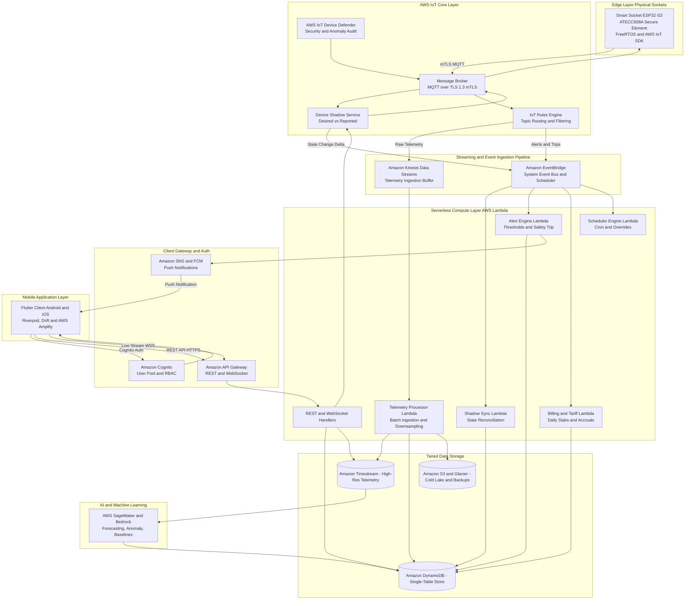

---

## 3. Hardware-to-Cloud Communication (Edge & IoT Plane)

### 3.1 Edge Microcontroller Specification
Each SEMS smart socket houses an **ESP32-S3** microcontroller paired with an **ATECC608A** cryptographic hardware secure element:
* **Microcontroller:** ESP32-S3 Dual-Core Xtensa LX7 @ 240MHz, 512KB SRAM, 8MB Flash.
* **Firmware Runtime:** FreeRTOS with AWS IoT Device SDK for Embedded C.
* **Metering Hardware:** High-precision bi-directional energy metering IC (e.g., Cirrus Logic CS5463 or STPM32) reading Voltage ($V$), Current ($I$), Active Power ($P$), Reactive Power ($Q$), Power Factor ($\text{PF}$), and Frequency ($f$).
* **Actuation:** 16A latching relay with zero-crossing detection circuit to prevent arcing and transient voltage spikes.

### 3.2 Cryptographic Identity & Fleet Provisioning
Every socket undergoes cryptographic provisioning during manufacturing to eliminate pre-shared keys and passwords.

#### Fleet Provisioning by Claim Lifecycle
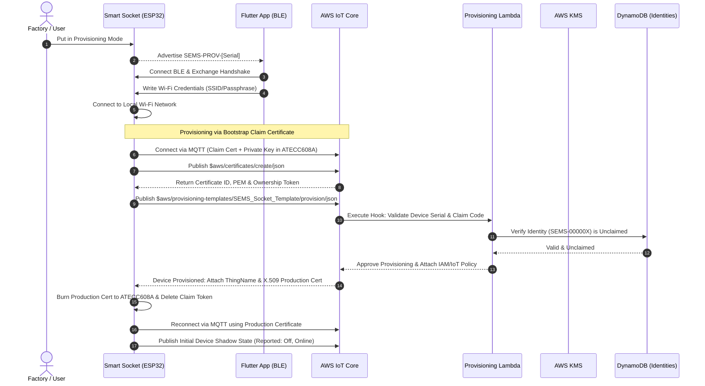

### 3.3 MQTT Topic Taxonomy
AWS IoT Core message routing follows a deterministic, hierarchical topic structure:

| Topic Pattern | Direction | QoS | Description |
|---|---|---|---|
| `sems/devices/{deviceId}/telemetry` | Device $\rightarrow$ Cloud | 0 / 1 | 10-second high-resolution electrical telemetry payload. |
| `sems/devices/{deviceId}/status` | Device $\rightarrow$ Cloud | 1 | Online / Offline status message (configured with LWT). |
| `sems/devices/{deviceId}/safety-trip` | Device $\rightarrow$ Cloud | 1 | High-priority safety trip report (overvoltage, overcurrent, thermal). |
| `sems/devices/{deviceId}/command/request` | Cloud $\rightarrow$ Device | 1 | RPC command request (relay toggle, reset trip, force calibrate). |
| `sems/devices/{deviceId}/command/response` | Device $\rightarrow$ Cloud | 1 | RPC command acknowledgement and execution result. |
| `$aws/things/{deviceId}/shadow/update` | Bi-directional | 1 | AWS Device Shadow state update (`desired` or `reported`). |
| `$aws/things/{deviceId}/shadow/update/delta` | Cloud $\rightarrow$ Device | 1 | Device Shadow difference notifying device of cloud state change. |
| `sems/devices/{deviceId}/config` | Cloud $\rightarrow$ Device | 1 | Safety limit threshold updates and schedule window bundles. |

### 3.4 Wire Payload Specifications

#### 3.4.1 Telemetry Sample Payload (`sems/devices/{deviceId}/telemetry`)
Emitted strictly every 10 seconds while the socket is active:
```json
{
  "version": "1.0",
  "device_id": "SEMS-000001",
  "seq": 48291,
  "ts": 1776615600,
  "relay": true,
  "voltage_v": 230.45,
  "current_a": 9.54,
  "power_w": 2198.50,
  "energy_kwh": 145.892,
  "frequency_hz": 50.02,
  "power_factor": 0.99,
  "temperature_c": 38.2,
  "signal_dbm": -58,
  "quality": "good"
}
```

#### 3.4.2 Last Will & Testament (LWT) Payload (`sems/devices/{deviceId}/status`)
Configured in the MQTT connect packet. If the socket drops without clean disconnect:
```json
{
  "device_id": "SEMS-000001",
  "status": "offline",
  "reason": "connection_lost",
  "ts": 1776615645
}
```

#### 3.4.3 Safety Trip Event Payload (`sems/devices/{deviceId}/safety-trip`)
Emitted instantly by the hardware circuit upon triggering protection cutoffs:
```json
{
  "device_id": "SEMS-000001",
  "event": "SAFETY_TRIP",
  "trip_reason": "OVER_CURRENT_DETECTED",
  "threshold_value": 16.0,
  "measured_value": 18.42,
  "relay_state": false,
  "lockout_seconds": 300,
  "ts": 1776615710
}
```

---

## 4. Cloud-to-Client Communication (App & User Plane)

### 4.1 Authentication, Multi-Tenancy & RBAC
User authentication leverages **Amazon Cognito User Pools** with OAuth 2.0 / OpenID Connect (OIDC).

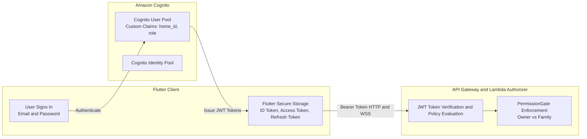

#### Custom JWT Claims
Every issued ID token contains household tenancy and role metadata:
```json
{
  "sub": "b2f6c91a-7b3c-4a8e-9d21-f92a18e3d012",
  "email": "asha.verma@sems.app",
  "custom:home_id": "HOME-884920",
  "custom:role": "OWNER",
  "cognito:groups": ["SEMS_OWNERS"],
  "iss": "https://cognito-idp.ap-south-1.amazonaws.com/ap-south-1_abcdef123",
  "exp": 1776619200
}
```

#### Permission Enforcement Matrix (App vs. Cloud Authorizer)
| Action | Owner Role | Family Role | Lambda Enforcement Logic |
|---|---|---|---|
| View Dashboard, Live Telemetry, History | Allowed | Allowed | Permitted if `custom:home_id` matches resource. |
| Toggle Relay (ON / OFF) | Allowed | Allowed | Permitted if device belongs to user's `home_id`. |
| Set Countdown Timers | Allowed | Allowed | Permitted. |
| Edit Recurring Schedules | Allowed | Allowed | Permitted. |
| Add / Commission Sockets | Allowed | **DENIED** | Returns `403 Forbidden` (`ErrPermissionDenied`). |
| Rename / Reassign Socket Rooms | Allowed | **DENIED** | Returns `403 Forbidden`. |
| Transfer Device Ownership | Allowed | **DENIED** | Returns `403 Forbidden`. |
| Add / Archive Appliances | Allowed | **DENIED** | Returns `403 Forbidden`. |
| Move Appliance Wizard | Allowed | **DENIED** | Returns `403 Forbidden`. |
| Modify Tariff Slabs & Billing Settings | Allowed | **DENIED** (Read-Only) | Returns `403 Forbidden`. |
| Cloud Backup & Restore | Allowed | **DENIED** | Returns `403 Forbidden`. |
| Manage Family Invitations | Allowed | **DENIED** | Returns `403 Forbidden`. |

---

## 5. Data Architecture & Storage Design

### 5.1 Storage Hierarchy & Lifecycles
SEMS separates hot operational data, ultra-high-frequency time series, and cold audit archives:
1. **Amazon DynamoDB (Hot Metadata & Current State):** User accounts, device metadata, appliance profiles, active meter sessions, schedules, alerts, tariffs, and current billing cycles.
2. **Amazon Timestream (Warm Time-Series Telemetry):** Ingests raw 10-second samples. Data retained in Memory Store for 24 hours, then moved to Magnetic Store for 90 days. Continuous queries downsample data into 1-minute, 1-hour, and 1-day aggregates.
3. **Amazon S3 & Glacier (Cold Storage Data Lake):** Telemetry older than 90 days is exported to S3 in Apache Parquet format (partitioned by `year/month/day/device_id`) via Kinesis Data Firehose for Athena ad-hoc querying and SageMaker ML training.

### 5.2 DynamoDB Single-Table Design
A single DynamoDB table named `sems_core_store` backs the operational data plane.

#### Key Schema
* **Partition Key (`PK`):** `STRING`
* **Sort Key (`SK`):** `STRING`
* **Global Secondary Index 1 (`GSI1PK`, `GSI1SK`):** Type-specific inverted index.
* **Global Secondary Index 2 (`GSI2PK`, `GSI2SK`):** Status and time-sorted queries.

#### Table Access Patterns
| Entity | `PK` | `SK` | `GSI1PK` | `GSI1SK` | Additional Attributes |
|---|---|---|---|---|---|
| **User Profile** | `USER#{userId}` | `METADATA` | `HOME#{homeId}` | `ROLE#{role}` | `name`, `email`, `role`, `createdAt` |
| **Home / Household** | `HOME#{homeId}` | `METADATA` | `HOME#{homeId}` | `METADATA` | `name`, `ownerId`, `address`, `timezone` |
| **Socket Device** | `HOME#{homeId}` | `DEV#{deviceId}` | `DEV#{deviceId}` | `STATE` | `name`, `room`, `applianceId`, `status`, `relay`, `voltage`, `power`, `meterKwh`, `safetyLimits` |
| **Appliance** | `HOME#{homeId}` | `APP#{applianceId}` | `APP#{applianceId}` | `METADATA` | `name`, `category`, `ratedPowerW`, `socketId`, `activeSessionId`, `isArchived` |
| **Meter Session** | `APP#{applianceId}` | `SESS#{sessionId}` | `DEV#{deviceId}` | `TS#{startTime}` | `startMeterKwh`, `endMeterKwh`, `sessionKwh`, `isActive` |
| **Schedule Rule** | `HOME#{homeId}` | `SCHED#{scheduleId}` | `APP#{applianceId}` | `SCHED` | `kind`, `enabled`, `intervals`, `days`, `isPaused` |
| **System Alert** | `HOME#{homeId}` | `ALERT#{timestamp}` | `DEV#{deviceId}` | `SEV#{severity}` | `title`, `cause`, `severity`, `acknowledged`, `isAi` |
| **Bill Record** | `HOME#{homeId}` | `BILL#{yearMonth}` | `BILL` | `TS#{billingDate}` | `billedKwh`, `billedAmount`, `effectiveRate`, `isPaid` |
| **Tariff Config** | `HOME#{homeId}` | `TARIFF#CURRENT` | `TARIFF` | `UPDATED#{ts}` | `currency`, `slabs`, `fixedCharge`, `dutyPercent`, `budget` |
| **Device Identity** | `DEV_IDENTITY` | `ID#{deviceId}` | `CLAIM#{claimCode}` | `STATUS` | `serial`, `model`, `claimCode`, `status`, `mqttCreds` |
| **Backup Manifest** | `HOME#{homeId}` | `BACKUP#{backupId}` | `BACKUP` | `TS#{timestamp}` | `s3Uri`, `checksumSha256`, `schemaVersion`, `recordCount` |

### 5.3 Amazon Timestream Schema
Table: `sems_telemetry_db.socket_readings`

* **Dimensions:**
  * `home_id` (VARCHAR)
  * `device_id` (VARCHAR)
  * `appliance_id` (VARCHAR)
  * `room` (VARCHAR)
  * `quality` (VARCHAR)
* **Measures:**
  * `voltage_v` (DOUBLE)
  * `current_a` (DOUBLE)
  * `power_w` (DOUBLE)
  * `energy_kwh` (DOUBLE)
  * `frequency_hz` (DOUBLE)
  * `power_factor` (DOUBLE)
  * `relay_state` (BOOLEAN)
  * `signal_dbm` (BIGINT)
* **Time:** Nanosecond timestamp.

---

## 6. Detailed Feature Subsystems & AWS Integration Mechanics

### 6.1 Remote Switching & Power Control Subsystem

#### 3-Phase State Machine
The UI never shows relay state mutation until physical execution is verified:
$$\text{PENDING} \longrightarrow \text{ACKNOWLEDGED} \longrightarrow \text{EXECUTED}$$

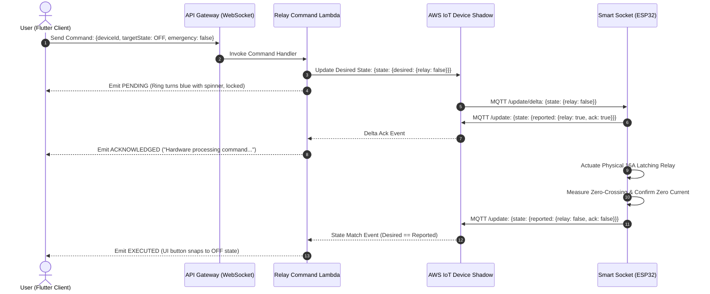

#### Error Handling & Timeouts:
* **Command Timeout:** If the socket does not report the matching state within **8 seconds**, Lambda marks the command `EXPIRED`, resets the desired shadow state, and emits `EXPIRED` to the client.
* **Safety Lockout:** If a safety trip is active on the socket, the Lambda Authorizer immediately rejects the `ON` request with error `423 Locked: Safety Trip Active`.

---

### 6.2 Appliance Management & Meter Session Mechanics
In SEMS, physical sockets measure raw cumulative energy, while appliances own runtime history.

#### The Move Appliance Session Preservation Protocol
When moving an appliance from Socket A to Socket B:
1. **Fetch Live Readings:** Query Socket A's current cumulative meter reading ($M_{A,\text{end}}$).
2. **Close Existing Session:**
   $$\Delta \text{SessionEnergy} = M_{A,\text{end}} - M_{A,\text{start}}$$
   Write end timestamp and cumulative kWh to DynamoDB `APP#{applianceId}/SESS#{sessionId}`.
3. **Detach Socket A:** Set Socket A's `applianceId = NULL`.
4. **Inspect Socket B:** If Socket B is occupied by another appliance, close that occupant's active session and preserve its history.
5. **Attach Socket B:** Link Socket B to the moved appliance.
6. **Open New Session:** Fetch Socket B's live meter reading ($M_{B,\text{start}}$) and create a new session entity.

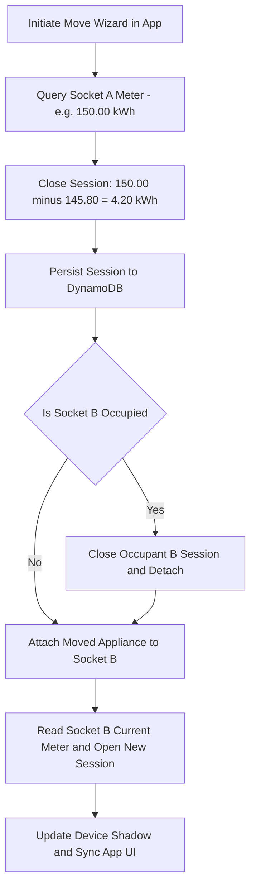

---

### 6.3 Smart Scheduling & Clock Sync Engine
Smart sockets must execute schedules reliably even during internet outages.

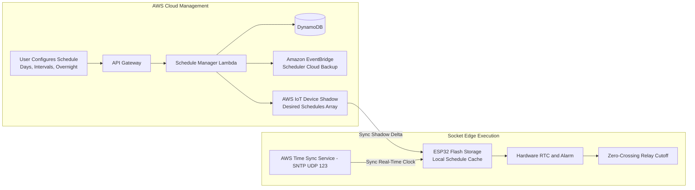

#### Time Synchronization Validation:
Before enabling schedule execution, the socket validates its clock against the **AWS Time Sync Service** (NTP). If `clockSynced == false`, the socket reports this in its shadow, and the Flutter app displays the **"Waiting for time sync"** banner, preventing unexpected activations.

---

### 6.4 Dynamic Tariff & Multi-Slab Billing Engine
The billing engine reconciles **Measured**, **Estimated**, and **Billed** energy amounts:

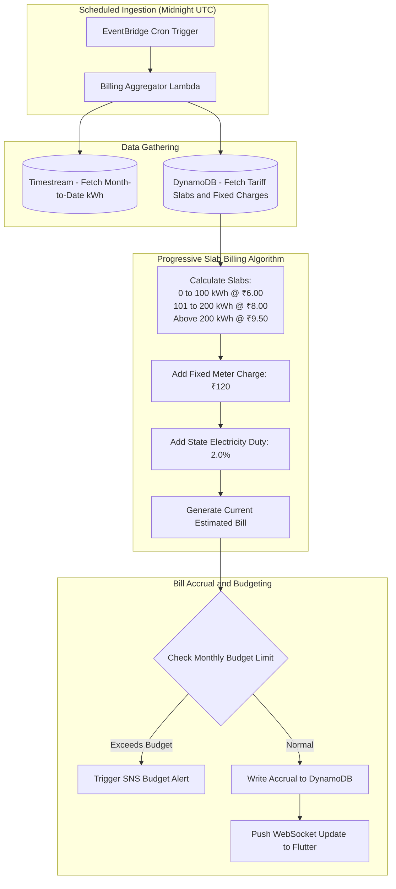

---

### 6.5 AI Energy Intelligence Pipeline & Coverage Gates
The AI subsystem enforces strict data-coverage gates to ensure statistical validity:

| Coverage Window | Unlocked Capabilities | Machine Learning Pipeline |
|---|---|---|
| **$< 3$ Days** | Basic measured statistics only. Learning card displayed. | None (Insufficient statistical baseline). |
| **$3 - 6$ Days** | Anomaly detection (spikes, standby leakage, vampire draw). | Rolling Z-score anomaly detector over 15-minute moving windows. |
| **$7 - 29$ Days** | 7-day load forecasting with confidence interval band. | Prophet / XGBoost model deployed on SageMaker Serverless. |
| **$30 - 59$ Days** | 30-day monthly billing forecast and appliance baselines. | DeepAR sequence-to-sequence neural network. |
| **$60+$ Days** | Seasonal pattern disaggregation, historical comparisons. | Foundation Model inference via **Amazon Bedrock** (Claude 3.5 Sonnet) generating contextual energy-saving recommendations. |

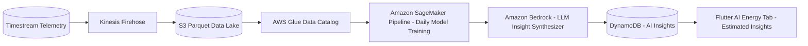

---

## 7. Complete API Specifications & Schema Contracts

### 7.1 RESTful OpenAPI Specification

#### Device Management APIs
* `GET /api/v1/devices` - List all sockets in the household.
* `GET /api/v1/devices/{id}` - Get full device details, telemetry, and safety limits.
* `POST /api/v1/devices/claim` - Claim an unclaimed socket identity using a 6-digit claim code.
* `PATCH /api/v1/devices/{id}` - Rename device or update room assignment (Owner only).
* `DELETE /api/v1/devices/{id}` - Unpair and factory-reset device (Owner only).
* `PUT /api/v1/devices/{id}/limits` - Update electrical safety limits (Overvoltage, Overcurrent, Thermal cutoff) (Owner only).

#### Appliance & Session APIs
* `GET /api/v1/appliances` - List all appliances (active and archived).
* `POST /api/v1/appliances` - Register a new appliance profile (Owner only).
* `POST /api/v1/appliances/{id}/move` - Execute atomic appliance move to a new socket (Owner only).
* `POST /api/v1/appliances/{id}/archive` - Archive an appliance (Owner only).

#### Remote Control APIs
* `POST /api/v1/devices/{id}/relay` - Initiate relay switching command (`ON` / `OFF`).
* `POST /api/v1/devices/{id}/emergency-off` - High-priority immediate emergency shutdown.
* `POST /api/v1/devices/{id}/timer` - Set countdown cutoff timer.

#### Scheduling APIs
* `GET /api/v1/schedules` - List active and paused schedules.
* `POST /api/v1/schedules` - Create or update a schedule rule.
* `DELETE /api/v1/schedules/{id}` - Delete a schedule rule.
* `POST /api/v1/schedules/pause` - Enable household holiday pause mode.
* `POST /api/v1/schedules/resume` - Resume all schedules.

#### Analytics & History APIs
* `GET /api/v1/analytics/history?range={10s|1m|1h|1d|1w|1mo}&applianceId={id}` - Fetch chart-ready downsampled time-series data.
* `POST /api/v1/analytics/export` - Request asynchronous export (CSV, Excel CSV, JSON, PDF).

#### Billing & Tariff APIs
* `GET /api/v1/billing/current` - Fetch month-to-date estimated bill, daily usage, and slab progress.
* `GET /api/v1/billing/history` - Fetch historical reconciled bills.
* `PUT /api/v1/billing/tariff` - Update progressive slab rates, fixed charges, and billing day (Owner only).

---

### 7.2 WebSocket Real-Time Event Protocol
Endpoint: `wss://api.sems.energy/ws/v1?token={CognitoJWT}`

#### Client $\rightarrow$ Server: Subscribe to Device Stream
```json
{
  "action": "subscribe",
  "topic": "devices/SEMS-000001/telemetry"
}
```

#### Server $\rightarrow$ Client: Live Telemetry Broadcast (Every 10s)
```json
{
  "event": "TELEMETRY_UPDATE",
  "data": {
    "device_id": "SEMS-000001",
    "power_w": 2200.4,
    "voltage_v": 230.1,
    "current_a": 9.56,
    "relay": true,
    "today_kwh": 4.90,
    "meter_kwh": 150.00,
    "ts": 1776615920
  }
}
```

#### Server $\rightarrow$ Client: Safety Trip Broadcast (Instant)
```json
{
  "event": "SAFETY_TRIP_TRIGGERED",
  "data": {
    "device_id": "SEMS-000001",
    "trip_reason": "OVER_CURRENT_DETECTED",
    "measured_value": 18.4,
    "lockout_remaining_seconds": 300,
    "ts": 1776615925
  }
}
```

---

## 8. Security, Governance & Compliance

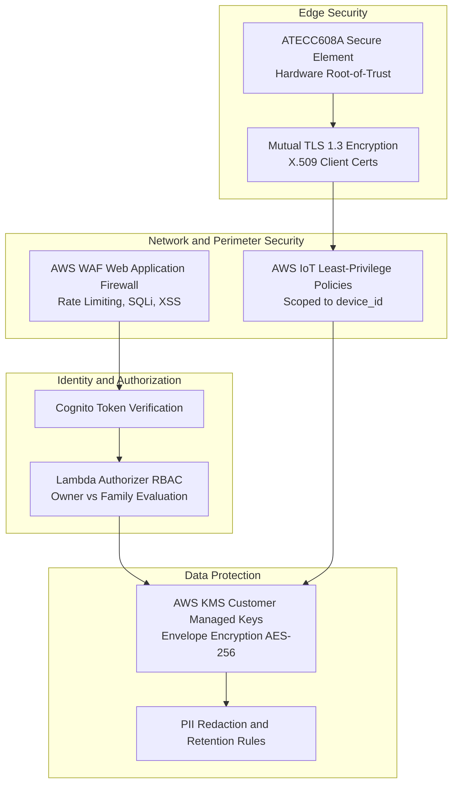

### 8.1 Critical Security Controls
1. **No Shared Passwords:** Hardware never stores or transmits Wi-Fi or MQTT broker credentials in plaintext.
2. **Device Isolation:** AWS IoT Core Policies restrict each socket so that device `SEMS-000001` can only publish and subscribe to its own device topics (`sems/devices/SEMS-000001/*`). It is cryptographically prohibited from intercepting another socket's messages.
3. **Firmware Integrity (OTA):** All Over-the-Air firmware updates are signed with an ECDSA private key held in AWS Certificate Manager / KMS. The ESP32 bootloader rejects unsigned or modified binaries.
4. **Data Privacy & GDPR/Data Protection Compliance:** Personal identifiable information (PII) is decoupled from telemetry. Telemetry in Timestream contains only anonymous identifiers (`device_id`).

---

## 9. Flutter Client Integration Architecture

### 9.1 Repository Adapter Substitution Pattern
The current Flutter application relies on `SemsRepository` backed by `DriftSemsRepository` and local simulators. The AWS migration replaces the mock implementation with `AwsSemsRepository` without altering presentation widgets.

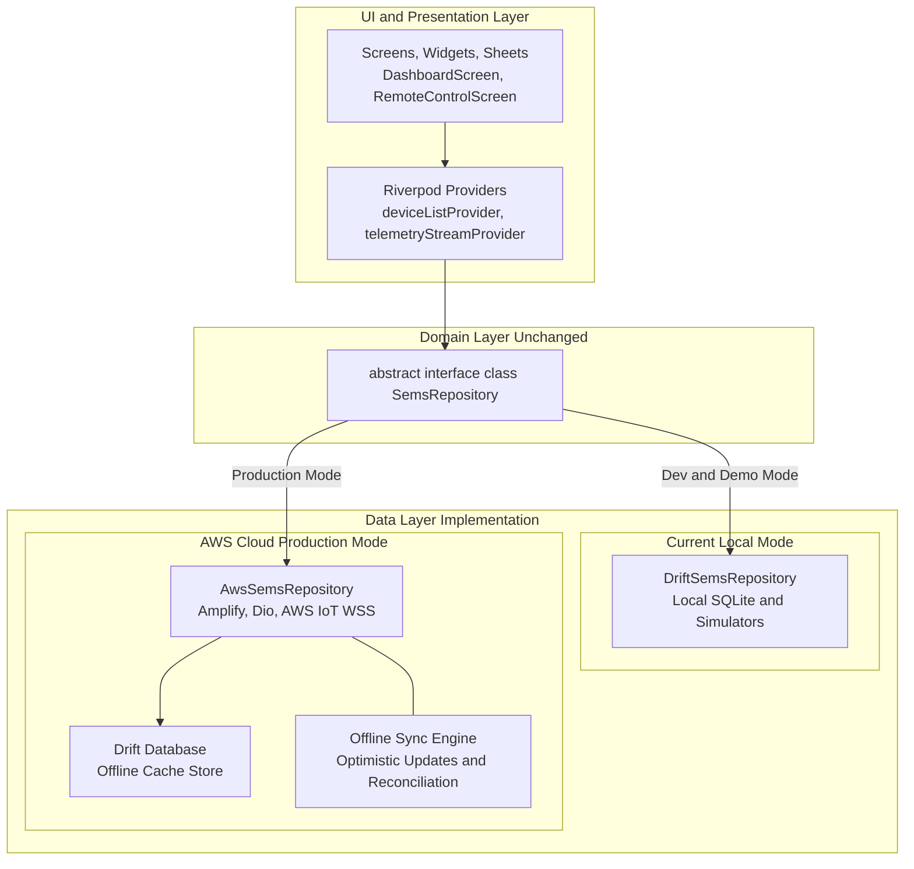

### 9.2 Offline-First Sync Architecture
* **Optimistic Local Mutation:** When a user toggles a relay or modifies a schedule while offline, the action is committed immediately to the local Drift database with a `sync_status = 'pending_upload'` flag.
* **Background Queue Reconciliation:** As soon as connectivity is restored, the `SyncEngine` drains the upload queue, invoking the corresponding AWS REST APIs.
* **Conflict Resolution Strategy:** Server state always wins (`Last-Write-Wins` with server timestamp verification) for device physical telemetry and safety trips.

---

## 10. Phased Implementation Roadmap & Milestones

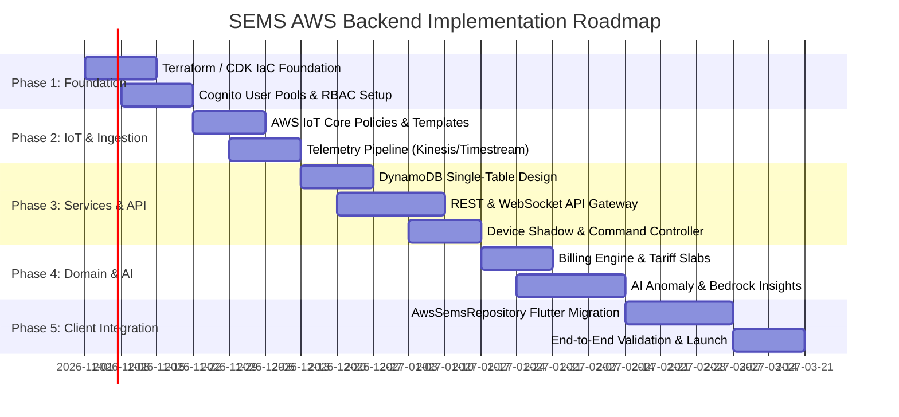

### Phase Details

#### Phase 1: Cloud Foundation & IaC Setup (Weeks 1–2)
* Provision multi-environment AWS accounts (Dev, Staging, Prod) using AWS Organizations.
* Implement 100% Infrastructure as Code (IaC) via **AWS CDK (TypeScript)** or **Terraform**.
* Deploy Amazon Cognito User Pools, App Clients, Custom Attributes (`home_id`, `role`), and Identity Pools.

#### Phase 2: IoT Core Setup & Ingestion Pipeline (Weeks 3–4)
* Configure AWS IoT Core endpoints, Fleet Provisioning by Claim templates, and X.509 Certificate Authorities.
* Provision Amazon Kinesis Data Streams and configure IoT Rules Engine to route telemetry samples.
* Set up Amazon Timestream database and continuous query aggregations (1m, 1h, 1d).

#### Phase 3: Operational Data Store & Microservices (Weeks 5–7)
* Deploy DynamoDB `sems_core_store` table with global secondary indexes.
* Develop serverless Lambda microservices for Device Shadow synchronization, command timeouts, and safety trips.
* Configure API Gateway (REST HTTP/2 & WebSocket APIs) secured by Cognito Lambda Authorizers.

#### Phase 4: Domain Services (Billing, Schedules, Alerts) (Weeks 8–10)
* Implement the progressive tariff slab calculation Lambda triggered daily by EventBridge.
* Deploy schedule synchronization workers and SNTP clock verification hooks.
* Integrate Amazon SNS and FCM/APNs for real-time mobile push notifications.

#### Phase 5: AI Engine & Machine Learning (Weeks 11–12)
* Implement Kinesis Data Firehose export to Amazon S3 cold data lake in Parquet format.
* Train and deploy rolling Z-score anomaly detection models on AWS SageMaker.
* Wire Amazon Bedrock prompt templates for personalized energy-saving insights.

#### Phase 6: Mobile Client Integration & Field Trials (Weeks 13–15)
* Implement `AwsSemsRepository` in the Flutter application using AWS Amplify and WebSockets.
* Integrate Drift database as an offline read-through and write-behind cache.
* Conduct field validation with 50 pilot smart sockets across various Wi-Fi conditions.

#### Phase 7: Security Audit & Production Launch (Week 16)
* Perform third-party penetration testing on hardware firmware, MQTT endpoints, and APIs.
* Enable AWS WAF rules, AWS Shield, and AWS IoT Device Defender audit alarms.
* Production cutover and deployment.

---

## 11. Cost & Scalability Estimation

### 11.1 Monthly Cost Model at Varying Device Scales (ap-south-1 Mumbai)

| AWS Service | 1,000 Sockets (USD) | 10,000 Sockets (USD) | 100,000 Sockets (USD) | Cost Optimization Strategy |
|---|---|---|---|---|
| **AWS IoT Core** | $4.20 | $42.00 | $420.00 | Basic Ingest rules bypass broker billing for raw telemetry. |
| **Amazon Kinesis** | $14.80 | $29.60 | $148.00 | Multi-device batching at edge if payload latency allows. |
| **AWS Lambda** | $3.50 | $32.00 | $285.00 | ARM64 Graviton3 architecture + optimized cold starts. |
| **Amazon Timestream** | $25.00 | $185.00 | $1,420.00 | 24-hr Memory store retention; downsampled Magnetic store. |
| **Amazon DynamoDB** | $5.00 | $35.00 | $290.00 | On-Demand capacity in Dev; Reserved Capacity in Prod. |
| **Amazon API Gateway** | $3.50 | $35.00 | $350.00 | WebSocket connection bundling + HTTP caching. |
| **Amazon Cognito** | $0.00 (Free tier) | $25.00 | $275.00 | Free tier covers first 50,000 MAU. |
| **Amazon S3 & Backup** | $2.00 | $15.00 | $110.00 | Intelligent Tiering with Glacier Instant Retrieval. |
| **Amazon Bedrock / AI** | $10.00 | $85.00 | $650.00 | Batch prompt inference once daily per household. |
| **Total Estimated / Mo** | **~$68.00** | **~$483.60** | **~$3,948.00** | **~$0.039 per device / month at scale** |

---

## 12. Conclusion & Next Steps
With this integration plan, the SEMS platform transitions from a local Flutter preview into an enterprise-ready, elastically scalable IoT ecosystem. The modular separation between the Flutter domain contracts and data repositories guarantees that **no mobile UI rewrites are required** when enabling AWS cloud connectivity.

### Immediate Next Actions:
1. Initialize the AWS CDK infrastructure repository (`sems-backend-infra`).
2. Implement the Cognito User Pool and configure the `custom:role` and `custom:home_id` attributes.
3. Configure the AWS IoT Core Fleet Provisioning template and test mTLS connectivity with ESP32-S3 hardware.
4. Begin development of `AwsSemsRepository` in Flutter to replace mock providers.
