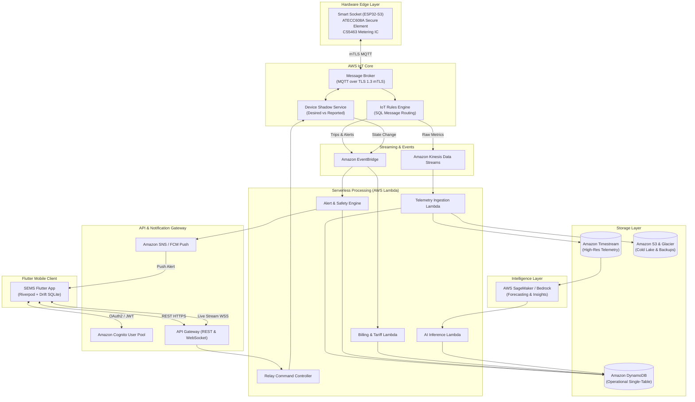
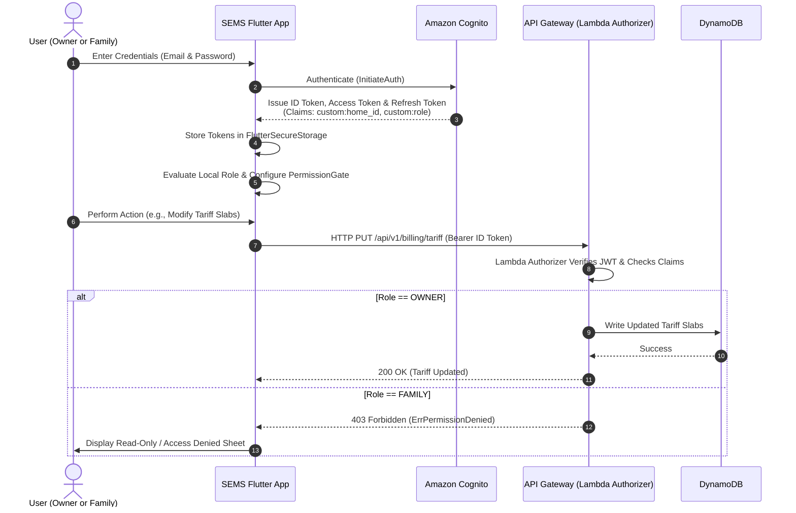
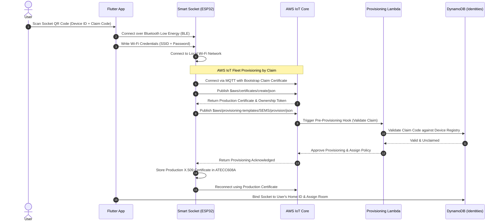
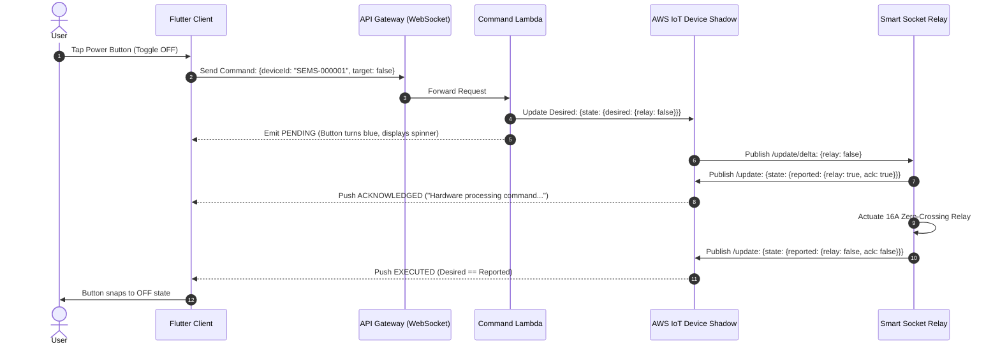
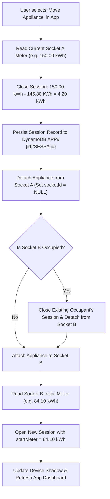
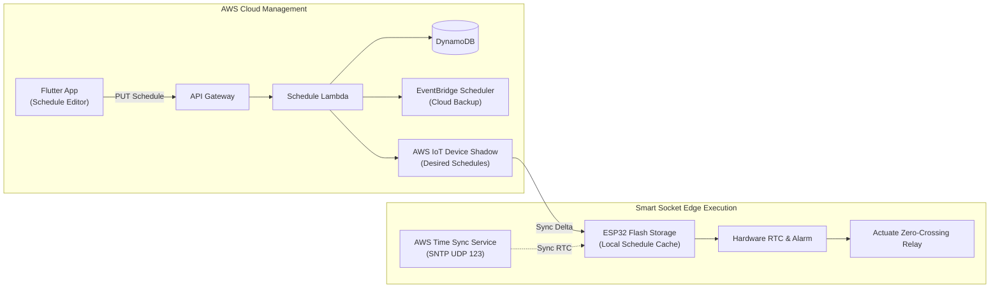
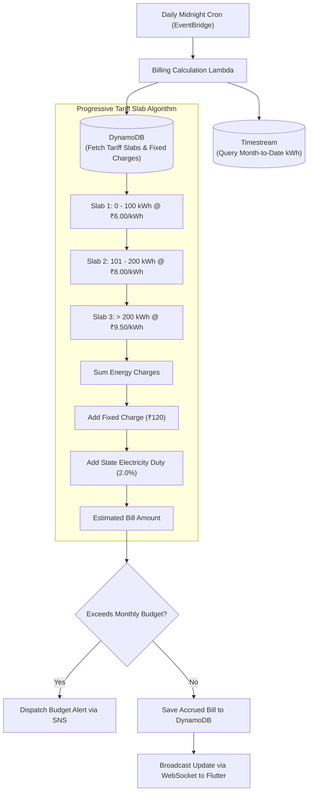
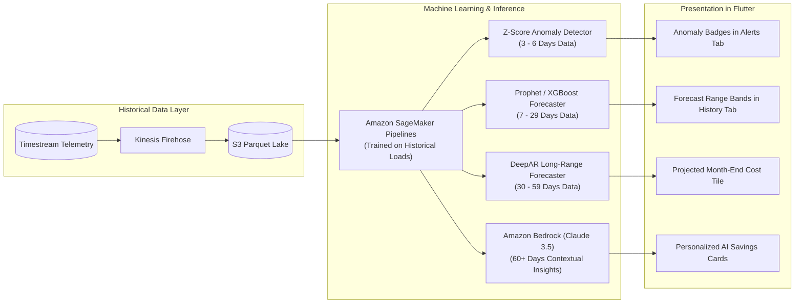
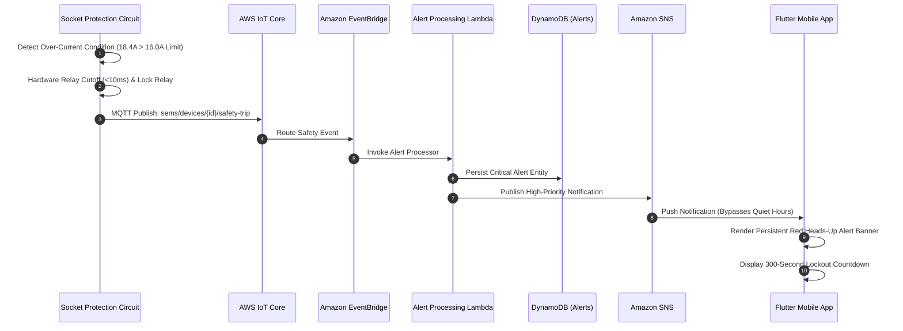
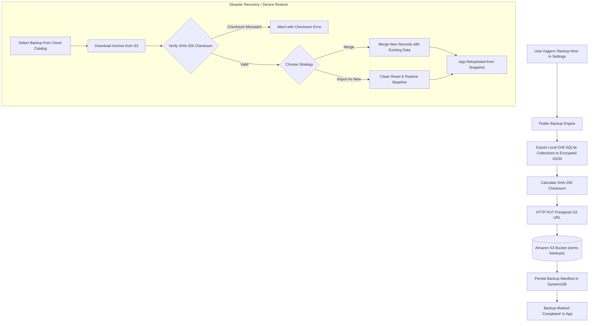

# Smart Energy Management System (SEMS)
**Enterprise IoT Energy Monitoring, Hardware Automation, and Multi-Slab Billing Platform**

[](https://flutter.dev)
[](https://dart.dev)
[](https://aws.amazon.com/iot-core/)
[](#architecture-and-codebase-structure)
[](#data-layer-and-storage-architecture)

---

## Table of Contents
1. [Project Overview & System Vision](#project-overview--system-vision)
2. [End-to-End System Architecture](#end-to-end-system-architecture)
3. [Comprehensive Features & Functional Breakdown](#comprehensive-features--functional-breakdown)
   - [3.1 Authentication & Multi-Tenancy (Owner vs. Family)](#31-authentication--multi-tenancy-owner-vs-family)
   - [3.2 Real-Time Dashboard & Live Power Monitoring](#32-real-time-dashboard--live-power-monitoring)
   - [3.3 Smart Sockets & Device Management](#33-smart-sockets--device-management)
   - [3.4 8-Step Device Commissioning & Claiming Flow](#34-8-step-device-commissioning--claiming-flow)
   - [3.5 Appliance Taxonomy & Meter Session Tracking](#35-appliance-taxonomy--meter-session-tracking)
   - [3.6 Remote Switching & Power Control Subsystem](#36-remote-switching--power-control-subsystem)
   - [3.7 Intelligent Scheduling & Automation Engine](#37-intelligent-scheduling--automation-engine)
   - [3.8 Energy History, Analytics & Telemetry Gap Handling](#38-energy-history-analytics--telemetry-gap-handling)
   - [3.9 Alerting & Safety Anomaly Subsystem](#39-alerting--safety-anomaly-subsystem)
   - [3.10 Billing Engine, Tariff Slabs & Budget Tracker](#310-billing-engine-tariff-slabs--budget-tracker)
   - [3.11 AI Energy Intelligence & Forecasting](#311-ai-energy-intelligence--forecasting)
   - [3.12 Cloud Backup & Disaster Recovery](#312-cloud-backup--disaster-recovery)
   - [3.13 Developer Mode & Factory Identity Lifecycle](#313-developer-mode--factory-identity-lifecycle)
4. [How SEMS Communicates with AWS](#how-sems-communicates-with-aws)
   - [4.1 Edge-to-Cloud Communication (MQTT over mTLS)](#41-edge-to-cloud-communication-mqtt-over-mtls)
   - [4.2 App-to-Cloud Communication (REST & WebSocket)](#42-app-to-cloud-communication-rest--websocket)
   - [4.3 Cloud-to-Edge Synchronization (AWS IoT Device Shadow)](#43-cloud-to-edge-synchronization-aws-iot-device-shadow)
   - [4.4 Protocol & Interface Matrix](#44-protocol--interface-matrix)
5. [System Flow & Architecture Diagrams](#system-flow--architecture-diagrams)
   - [Diagram 1: End-to-End High-Level Architecture](#diagram-1-end-to-end-high-level-architecture)
   - [Diagram 2: User Authentication & Role Authorization Flow](#diagram-2-user-authentication--role-authorization-flow)
   - [Diagram 3: Socket Commissioning & Device Claiming Pipeline](#diagram-3-socket-commissioning--device-claiming-pipeline)
   - [Diagram 4: High-Frequency Telemetry Ingestion Pipeline](#diagram-4-high-frequency-telemetry-ingestion-pipeline)
   - [Diagram 5: Remote Control & State Synchronization Flow](#diagram-5-remote-control--state-synchronization-flow)
   - [Diagram 6: Appliance Move Wizard with Session Preservation](#diagram-6-appliance-move-wizard-with-session-preservation)
   - [Diagram 7: Smart Scheduling & Time Synchronization Flow](#diagram-7-smart-scheduling--time-synchronization-flow)
   - [Diagram 8: Tariff Slab Calculation & Billing Pipeline](#diagram-8-tariff-slab-calculation--billing-pipeline)
   - [Diagram 9: AI Energy Intelligence & Multi-Tier Coverage Pipeline](#diagram-9-ai-energy-intelligence--multi-tier-coverage-pipeline)
   - [Diagram 10: Critical Alert Detection, Safety Trip & Push Notification Flow](#diagram-10-critical-alert-detection-safety-trip--push-notification-flow)
   - [Diagram 11: Cloud Backup & Snapshot Disaster Recovery Flow](#diagram-11-cloud-backup--snapshot-disaster-recovery-flow)
6. [Architecture & Codebase Structure](#architecture--codebase-structure)
7. [Running Locally & Mock Exploration](#running-locally--mock-exploration)
8. [AWS Backend Integration Roadmap](#aws-backend-integration-roadmap)

---

## Project Overview & System Vision

**SEMS (Smart Energy Management System)** is an IoT energy management and automation ecosystem. It monitors energy consumption at the individual socket and appliance level, automates loads via scheduling and remote control, calculates electricity bills using progressive multi-slab tariffs, and delivers AI-driven energy conservation recommendations.

### Key Capabilities
* **Granular Sub-Metered Energy Telemetry:** High-frequency electrical monitoring (Voltage, Current, Active/Reactive Power, Power Factor, and Frequency) captured every 10 seconds.
* **Bi-Directional State Synchronization:** Cloud-managed relay switching with sub-second feedback using AWS IoT Device Shadows (`PENDING` $\rightarrow$ `ACKNOWLEDGED` $\rightarrow$ `EXECUTED`).
* **Offline-First Resilience:** Local SQLite database ([Drift](https://drift.simonbinder.eu/)) acts as an offline cache and storage engine; operations queue locally and synchronize transparently with AWS when connectivity resumes.
* **Separation of Metering and Appliance Life:** Physical sockets accumulate lifetime kilowatt-hours, while logical appliances own discrete **meter sessions**, enabling users to move appliances across sockets without corrupting historical usage.
* **Accurate Billing Reconciliation:** Differentiates between **Measured** energy, **Estimated** energy (progressive tariff slabs, fixed charges, and government electricity duties), and verified **Billed** utility statements.
* **Progressive AI Coverage Gates:** Machine learning algorithms adapt based on historical data depth ($<3$ days learning, $3-6$ days anomaly detection, $7-29$ days short-term forecasting, $30-59$ days monthly projection, and $60+$ days seasonal disaggregation).

---

## End-to-End System Architecture

SEMS is divided into three interconnected operational layers:

```
┌─────────────────────────────────┐
│     Physical Smart Sockets      │  ◄── Hardware Edge Layer
│   (ESP32-S3 + ATECC608A + Meter) │      (FreeRTOS, MQTT over mTLS X.509)
└────────────────┬────────────────┘
                 │
                 ▼
┌─────────────────────────────────┐
│       AWS Cloud Platform        │  ◄── Ingestion, State & Intelligence Layer
│ (IoT Core, Timestream, DynamoDB) │      (Serverless Microservices, Bedrock/SageMaker)
└────────────────┬────────────────┘
                 │
                 ▼
┌─────────────────────────────────┐
│      SEMS Flutter Client        │  ◄── User Presentation Layer
│   (Android, iOS, Web Dashboard) │      (Riverpod, Drift SQLite, AWS Amplify)
└─────────────────────────────────┘
```

1. **Hardware Edge Layer:** Custom smart sockets with dedicated energy metering ICs, latching relays, zero-crossing protection, and hardware cryptographic chips (Microchip ATECC608A) communicating over Wi-Fi via MQTT over TLS 1.3.
2. **AWS Cloud Platform:** Fully managed, serverless backend comprising AWS IoT Core, Amazon Kinesis, Amazon Timestream, Amazon DynamoDB, AWS Lambda, Amazon EventBridge, and AWS Bedrock/SageMaker for AI inference.
3. **Flutter Client Layer:** Multiplatform Flutter application utilizing **Riverpod** for reactive state management, **GoRouter** for role-guarded routing, and clean architectural separation between presentation, domain, and data layers.

---

## Comprehensive Features & Functional Breakdown

### 3.1 Authentication & Multi-Tenancy (Owner vs. Family)
SEMS enforces household-scoped multi-tenancy backed by **Amazon Cognito User Pools**.
* **Role-Based Access Control (RBAC):** Every authenticated account is assigned either an **Owner** or **Family** role via custom JWT claims (`custom:role`).
* **Permission Gate Enforcement (`PermissionGate`):** The UI dynamically adapts based on active credentials:
  * **Owner:** Full administrative rights (device pairing, appliance moves, tariff slab editing, cloud backups, member invitations, account deletion).
  * **Family:** Restricted access (view dashboard, inspect live readings, toggle power relays, configure schedules). Administrative actions are hidden, dimmed, or guarded by confirmation dialogs.
* **Local Developer Bypass:** Developer authentication allows engineers to test edge conditions and firmware provisioning without creating public production accounts.

### 3.2 Real-Time Dashboard & Live Power Monitoring
* **Live Household Consumption:** Displays instantaneous active load in Watts ($W$), refreshed every 10 seconds.
* **24-Hour Load Profile:** Interactive load visualization highlighting peak usage hours, past consumption, and forecast bands.
* **Metric Tiles:** Shows Today’s Energy (kWh), Current Billing Cycle Total (kWh), and Estimated Bill so Far (₹ / $), strictly distinguishing between *Measured*, *Estimated*, and *Billed* values.
* **Room-by-Room Breakdown:** Filter sockets and appliances by room chips (Living Room, Kitchen, Master Bedroom, Home Office).
* **Heads-Up Alert Banner:** Critical alerts (safety trips, overcurrent events) trigger persistent overlay banners requiring explicit acknowledgement.

### 3.3 Smart Sockets & Device Management
* **Live Telemetry Inspection:** Detailed view rendering 6 live parameters: Voltage ($V$), Current ($A$), Active Power ($W$), Cumulative Meter ($kWh$), Power Factor ($\text{PF}$), and Network Signal ($dBm$).
* **Electrical Safety Thresholds:** Configurable trip limits for Over-Voltage (e.g., $>260V$), Over-Current (e.g., $>16A$), and Under-Voltage. If tripped, the socket locks off and begins a safety countdown.
* **Device Management Operations:** Rename socket, reassign room, reconfigure Wi-Fi credentials via Bluetooth Low Energy (BLE), transfer ownership, or remove device.

### 3.4 8-Step Device Commissioning & Claiming Flow
Adding a smart socket follows an 8-step wizard designed to eliminate pre-shared keys and manual configuration:
1. **Scan QR Code:** Scans socket identity QR code encoding Device ID and 6-digit Claim Code.
2. **Validate Claim:** Validates code against the cloud registry to prevent duplicate claims.
3. **BLE Discovery:** Discovers socket in pairing mode via Bluetooth Low Energy.
4. **Security Handshake:** Establishes an encrypted ECDH channel between app and socket.
5. **Wi-Fi Provisioning:** Transfers local 2.4 GHz Wi-Fi credentials to the socket.
6. **Cloud Connection:** Socket joins Wi-Fi and connects to AWS IoT Core using a bootstrap claim certificate.
7. **Fleet Provisioning:** AWS IoT Core executes a provisioning hook, binds the socket to the household, issues a production X.509 certificate, and deletes the temporary claim token.
8. **Naming & Room Assignment:** User assigns a friendly name, room, and connected appliance.

*Handled Error States:* Invalid QR Code, Bluetooth Not Found, Wi-Fi Connection Failure, Claim Code Expired, Already Claimed, Timeout, and Device Locked.

### 3.5 Appliance Taxonomy & Meter Session Tracking
SEMS separates physical sockets from the appliances plugged into them:
* **Appliance Categories:** Specialized profiles with standard power ratings (Heater, Air Conditioner, Refrigerator, Fan, Water Heater, Lighting, Television, Other).
* **Discrete Meter Sessions:** When an appliance is plugged into a socket, an **Energy Session** starts. The session records start meter reading, end meter reading, runtime, and total session kWh ($\Delta kWh = \text{End} - \text{Start}$).
* **Move Appliance Wizard:** When moving an appliance from Socket A to Socket B:
  1. The active session on Socket A is closed and its history is saved.
  2. If Socket B is occupied, its existing occupant's session is closed and detached.
  3. The moved appliance attaches to Socket B and a new session starts at Socket B's current meter count.
  4. Historical data for both appliances remains intact.

### 3.6 Remote Switching & Power Control Subsystem
* **State Machine Execution:**
  $$\text{PENDING} \longrightarrow \text{ACKNOWLEDGED} \longrightarrow \text{EXECUTED}$$
  Tapping the power button initiates a `PENDING` state (pulsing ring, controls locked). The UI transitions to `ACKNOWLEDGED` when AWS IoT Core receives the command, and to `EXECUTED` once the hardware confirms zero-crossing relay actuation.
* **Countdown Timers:** Set automatic power-off timers (e.g., 15 mins, 30 mins, 2 hours).
* **Emergency OFF:** High-priority command that bypasses cloud queues to trigger an immediate hardware cutoff.
* **Safety Lockout Interlock:** If an electrical safety trip is active, the relay is hardware-locked; remote `ON` commands are rejected until the cooldown period expires.

### 3.7 Intelligent Scheduling & Automation Engine
* **Schedule Types:** Supports Countdown, One-Time, Daily, Weekly, Multiple Time Intervals per Day, and Overnight (crossing midnight) windows.
* **Overlap & Conflict Validation:** Validates schedules across appliances to prevent overlapping active windows.
* **Holiday Pause Mode:** Temporarily suspends all scheduled automations without deleting configurations.
* **Hardware Clock-Sync Verification:** Devices validate their hardware Real-Time Clock (RTC) with AWS Time Sync Service (NTP). If unsynced, the app displays a **"Waiting for time sync"** banner, preventing mis-timed activations.

### 3.8 Energy History, Analytics & Telemetry Gap Handling
* **Multi-Scale Timeframes:** Drill into consumption across 10-Second, 1-Minute, 1-Hour, 1-Day, 1-Week, and 1-Month intervals.
* **Telemetry Gap Detection:** If network outages cause missing samples, SEMS renders a hatched **"Data Gap"** overlay rather than interpolating false energy readings.
* **Data Export:** Asynchronous export of raw or aggregated telemetry to CSV, Excel-compatible CSV, JSON, and formatted PDF.

### 3.9 Alerting & Safety Anomaly Subsystem
* **Alert Categories:** Electrical (overvoltage, overcurrent, power factor drop), Energy (unusual standby consumption, budget threshold breach), Connectivity (socket offline $>15$ minutes), Automation (schedule failed), and AI Insights.
* **Quiet Hours:** Mutes non-critical notifications during sleep windows while allowing critical safety trips to break through.
* **Acknowledgement Workflow:** Track and clear alerts with timestamps and user attribution.

### 3.10 Billing Engine, Tariff Slabs & Budget Tracker
* **Progressive Multi-Slab Calculator:** Calculates cost across tiered energy slabs (e.g., 0–100 kWh @ ₹6.00, 101–200 kWh @ ₹8.00, $>200$ kWh @ ₹9.50).
* **Fixed Charges & Statutory Duties:** Incorporates monthly fixed meter connection fees and percentage-based electricity duties.
* **Reconciliation Engine:** Compares ongoing **Estimated Bills** against historic **Billed Invoices** to calculate effective kWh rates and alert when actual usage exceeds the monthly budget.

### 3.11 AI Energy Intelligence & Forecasting
* **Data-Coverage Gated Insights:**
  * **$< 3$ Days:** Baseline learning phase; standard telemetry collection only.
  * **$3 - 6$ Days:** Rolling anomaly detection identifies standby power loss and vampire draw.
  * **$7 - 29$ Days:** Short-term load forecasting with confidence interval bands.
  * **$30 - 59$ Days:** 30-day monthly budget projection and per-appliance baselines.
  * **$60+$ Days:** Seasonal load disaggregation and automated savings recommendations.

### 3.12 Cloud Backup & Disaster Recovery
* **Encrypted Cloud Snapshots:** Serializes appliance profiles, historical sessions, schedules, tariffs, and user preferences into encrypted JSON archives backed by Amazon S3.
* **Checksum Verification:** Every snapshot includes a SHA-256 integrity hash and schema version identifier.
* **Conflict Resolution:** Restore wizard supports both **Merge** (appends new records without overwriting) and **Import as New** strategies.

### 3.13 Developer Mode & Factory Identity Lifecycle
* **Secret Access Trigger:** Long-pressing the brand logo on the sign-in screen unlocks developer tools.
* **Factory Socket Provisioning:** Generates immutable hardware identities (`SEMS-00000X`), MAC serial bindings, and single-use claim codes for firmware flashing.
* **Scenario Presets:** In offline preview mode, allows instant switching between 15 edge-case scenarios (`socketOffline`, `safetyTrip`, `learning2Days`, `strong45Days`, etc.).

---

## How SEMS Communicates with AWS

### 4.1 Edge-to-Cloud Communication (MQTT over mTLS)
Every physical smart socket runs FreeRTOS with the AWS IoT Device SDK. It connects to the AWS IoT Core Message Broker on port 8883 using **TLS 1.3 with Mutual Authentication (mTLS)**:
* **Client Certificate:** Stored in the hardware secure element (ATECC608A); the private key never leaves silicon.
* **Telemetry Publish (`sems/devices/{id}/telemetry`):** 10-second JSON payload containing instantaneous electrical metrics.
* **Status / LWT (`sems/devices/{id}/status`):** MQTT Last Will and Testament automatically marks sockets offline in the cloud within seconds of a power drop.
* **Safety Trip (`sems/devices/{id}/safety-trip`):** Immediate high-priority event published when hardware breakers trip.

### 4.2 App-to-Cloud Communication (REST & WebSocket)
The Flutter application communicates through **Amazon API Gateway**:
* **HTTPS REST API:** Used for transactional CRUD operations (device claiming, profile updates, tariff editing, schedule management, historical data queries).
* **WebSocket API (`wss://api.sems.energy/ws/v1`):** Establishes an authenticated bidirectional channel for real-time telemetry streaming and instant relay command execution.

### 4.3 Cloud-to-Edge Synchronization (AWS IoT Device Shadow)
SEMS leverages the **AWS IoT Device Shadow** to reconcile state differences between the mobile app and physical hardware:
* **Desired State:** Mobile app requests relay `OFF` by updating `$aws/things/{id}/shadow/update` with `desired.relay = false`.
* **Delta Notification:** AWS IoT Core sends an asynchronous `/update/delta` message to the socket over MQTT.
* **Reported State:** Once the socket's relay trips, it publishes `reported.relay = false` back to the shadow, clearing the delta and notifying the mobile app.

### 4.4 Protocol & Interface Matrix

| Channel | Source $\rightarrow$ Destination | Protocol | Security / Auth | Update Frequency |
|---|---|---|---|---|
| **Live Telemetry** | Socket $\rightarrow$ AWS IoT Core | MQTT | TLS 1.3 / X.509 mTLS | Every 10 seconds |
| **State Sync** | Socket $\leftrightarrow$ AWS Device Shadow | MQTT | TLS 1.3 / X.509 mTLS | Event-driven / On state change |
| **Command RPC** | Cloud $\rightarrow$ Socket | MQTT | TLS 1.3 / X.509 mTLS | On user action ($<500\text{ms}$) |
| **App Telemetry** | AWS $\rightarrow$ Flutter App | WebSocket | WSS / Cognito JWT | Every 10 seconds (Stream) |
| **REST Operations** | Flutter App $\rightarrow$ API Gateway | HTTPS (REST) | TLS 1.3 / Cognito Bearer | On demand |
| **Push Alerts** | AWS SNS $\rightarrow$ Mobile App | FCM / APNs | Cloud Messaging Tokens | Instant (Event-driven) |

---

## System Flow & Architecture Diagrams

### Diagram 1: End-to-End High-Level Architecture



---

### Diagram 2: User Authentication & Role Authorization Flow



---

### Diagram 3: Socket Commissioning & Device Claiming Pipeline



---

### Diagram 4: High-Frequency Telemetry Ingestion Pipeline

```mermaid
flowchart LR
    Socket["Smart Socket<br/>(10s Cadence)"] -->|MQTT Publish| IoTCore["AWS IoT Core Rules Engine"]
    IoTCore -->|Batch SQL Filter| Kinesis["Amazon Kinesis Data Streams"]
    Kinesis -->|Consumer Batch| Lambda["Telemetry Processor Lambda"]
    Lambda -->|Raw 10s Metric Samples| Timestream[("Amazon Timestream<br/>(24h Memory / 90d Magnetic)")]
    Lambda -->|Update Current State| DynamoDB[("Amazon DynamoDB<br/>(Live Wattage & Meter)")]
    Lambda -->|Archive Batches (Parquet)| Firehose["Kinesis Firehose"]
    Firehose --> S3[("Amazon S3 Cold Lake")]
```

---

### Diagram 5: Remote Control & State Synchronization Flow



---

### Diagram 6: Appliance Move Wizard with Session Preservation



---

### Diagram 7: Smart Scheduling & Time Synchronization Flow



---

### Diagram 8: Tariff Slab Calculation & Billing Pipeline



---

### Diagram 9: AI Energy Intelligence & Multi-Tier Coverage Pipeline



---

### Diagram 10: Critical Alert Detection, Safety Trip & Push Notification Flow



---

### Diagram 11: Cloud Backup & Snapshot Disaster Recovery Flow



---

## Architecture & Codebase Structure

The SEMS codebase follows Clean Architecture principles, ensuring UI components are decoupled from data sources and business logic:

```
lib/
├── app/                      # MaterialApp.router, AppRouter, Route Constants & Guards
├── core/
│   ├── constants/            # Asset paths, operational limits, timeouts
│   ├── errors/               # AppException definitions and failure types
│   ├── theme/                # Centralized Figma design tokens (Colors, Typography, Radii)
│   └── utils/                # Formatters (₹ INR, kWh, Watts, Dates) and Validators
├── domain/                   # Pure Dart business rules (Zero Flutter dependencies)
│   ├── enums/                # Role, RelayState, AlertSeverity, CommandState
│   ├── models/               # Freezed immutable entities (Socket, Appliance, Session, Tariff)
│   ├── repositories/         # Abstract repository contracts
│   └── usecases/             # Bill estimator, schedule validator, permission rules
├── data/
│   ├── local_db/             # Drift SQLite database schema and DAOs
│   ├── mock/                 # In-memory mock repositories and seeders
│   └── repositories/         # Drift-backed and AWS-backed repository implementations
├── features/                 # Modular feature implementations
│   ├── auth/                 # Sign In, Sign Up, Email Verification
│   ├── dashboard/            # Real-time power metrics, load bars, heads-up alerts
│   ├── devices/              # Sockets list, detail view, safety limits
│   ├── appliances/           # Appliance catalog, session views, move wizard
│   ├── control/              # Remote switching, timer sheets, emergency OFF
│   ├── scheduling/           # Schedule list, multi-interval editor, holiday pause
│   ├── history/              # Multi-scale charts, telemetry gap overlays, data export
│   ├── alerts/               # Categorized alert lists, detail sheets, quiet hours
│   ├── billing/              # Tariff slab editor, budget meter, bill history
│   ├── ai/                   # AI energy insights, forecast bands, coverage gates
│   ├── backup/               # Snapshot creation, checksum validation, restore wizard
│   ├── settings/             # Member permissions, profile, notification rules
│   └── developer/            # Factory identity generator, scenario switcher
└── shared/
    └── widgets/              # Reusable components conforming to Figma design system
```

---

## Running Locally & Mock Exploration

The SEMS frontend preview can be explored without cloud credentials or hardware. It includes mock repositories, realistic hardware simulators, and 15 pre-configured scenario presets.

### Prerequisites
* Flutter SDK: `^3.47.0`
* Dart SDK: `^3.13.5`

### 1. Install Dependencies
```sh
flutter pub get
```

### 2. Run the Application
To run on a connected Android device or emulator:
```sh
flutter run
```

To run in Google Chrome:
```sh
flutter run -d chrome
```

### 3. Explore Demo Flows
* **Bypass Auth:** On the onboarding screen, tap **Skip $\rightarrow$ Continue as demo user** to enter as household **Owner (Asha Verma)**.
* **Inspect Hardware Control:** Navigate to **Devices $\rightarrow$ SEMS-000001 (Living Room Heater) $\rightarrow$ Remote Control**. Tap the power button to observe the `PENDING` $\rightarrow$ `ACKNOWLEDGED` $\rightarrow$ `EXECUTED` state machine.
* **Test Appliance Moves:** Navigate to **More $\rightarrow$ Appliances $\rightarrow$ Heater $\rightarrow$ Move Appliance** to run the 3-step wizard and verify session preservation.
* **Switch Scenarios:** Long-press the brand logo on the sign-in screen to enter **Developer Mode**, then open **Mock Controls** to activate presets like `socketOffline`, `safetyTrip`, or `strong45Days`.

### 4. Code Verification
```sh
flutter analyze
flutter test
```

---

## AWS Backend Integration Roadmap

To transition from the offline-first preview to production AWS infrastructure, refer to the detailed engineering guide:

👉 **[Complete AWS Backend Integration Plan (AWS_BACKEND_INTEGRATION_PLAN.md)](file:///d:/flutter_env/sems/AWS_BACKEND_INTEGRATION_PLAN.md)**

The plan covers:
1. **Infrastructure as Code (IaC):** AWS CDK TypeScript templates for IoT Core, DynamoDB, and Cognito.
2. **Firmware Guidelines:** ESP32-S3 FreeRTOS mTLS setup with ATECC608A secure elements.
3. **Database Schemas:** DynamoDB single-table schema and Amazon Timestream table layouts.
4. **Client Repository Migration:** Step-by-step instructions for replacing `DriftSemsRepository` with `AwsSemsRepository`.
5. **Cost Projections:** Infrastructure cost models for 1,000, 10,000, and 100,000 connected smart sockets.
